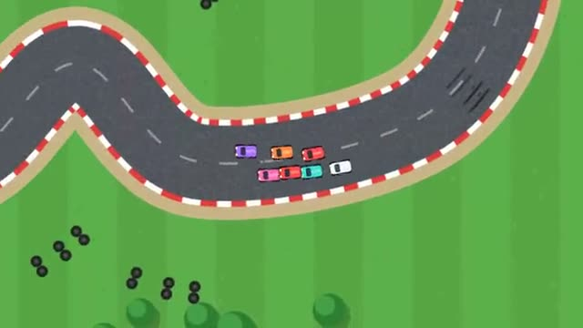

# Top-Down Rally

Tiny cars and tight corners. A multiplayer starter game from [Multiplayer Agent](https://multiplayeragent.com): 2D, versus, 2–6 players, with bots that fill empty seats.

## How it plays

Race tiny cars around a top-down track. Grass slows you down. Hold drift through a corner and let go for a boost. Three laps, then on to the next track.

**Controls:** Arrow keys or WASD, Shift or Space to drift, or on-screen buttons.

## Make it yours in the Game Builder

Open the [Game Builder](https://multiplayeragent.com), choose **Start from a starter game** and pick Top-Down Rally. It opens as version 1 in your studio, ready to play and publish. Then ask for changes, for example:

- Add oil slicks that spin cars
- Set the track on a kitchen table
- Add a lap timer with a ghost of your best lap

## Run it yourself

1. Get a free publishable key (`pk_…`) at [multiplayeragent.com](https://multiplayeragent.com).
2. In `index.html`, put it in place of `pk_REPLACE_ME` in the `MP_CONNECT` block.
3. Open `index.html` in a browser. No build step and no server needed.

Without a key it still runs, offline against bots.

## How it is built

- One `index.html`. The comment at the top of the script maps the code and explains the multiplayer. The tracks are lists of points in `CONFIG.tracks`: add one and it joins the rotation.
- **Leaderboard:** The fastest laps on each track.
- **Host-run rounds:** Races start, finish and move to the next track together for everyone.
- **Bots:** Rubber-banded bots fill the grid until enough people join.
- **Live sync:** Every car moves for everyone at once.
- `?attract` runs it offline with bots only. The preview video is recorded from it.

## License

MIT.
